# Nodal

**Parametric modeling and structural finite element analysis in your browser.** Place components on a canvas, connect them with wires, and watch the 3D model and its structural response update as you drag a slider. Free, open source, no install, no account, no server.

### [Open Nodal](https://hse95.github.io/nodal/)

> [!IMPORTANT]
> Nodal is provided as is, without warranty. It is a tool for exploration, teaching and early-stage design. **Check every result independently before using it for any real design.** The "utilization" it reports is a simplified stress ratio and is not a design-code check.

[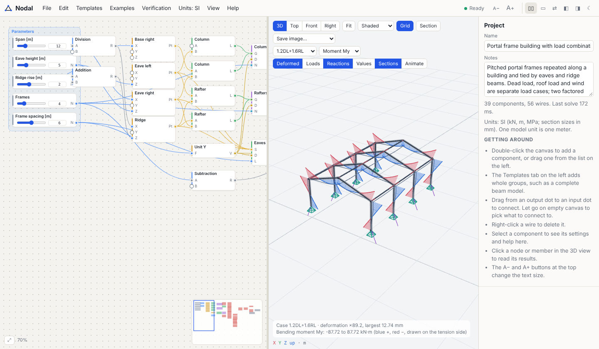](docs/media/hero.png)

## Why Nodal

Parametric structural design usually needs a CAD package, a visual programming add-on and a finite element plug-in, each with its own license. I wanted one link I could send to a student or a colleague that opens a working parametric model with a real solver behind it, and that shows how far its answers can be trusted.

- **Everything runs on your computer.** The app is a static page. Your models are not uploaded anywhere.
- **The solver is checked in the open.** 28 benchmarks against closed-form solutions and published reference values run in the test suite and inside the app, with the computed value, the reference, the error and the tolerance shown for each check.
- **It says what it does not do.** The [theory manual](docs/theory-manual.md) lists every formulation, sign convention and known limitation.

## See it in action

### Start from a template

The Templates tab drops a complete small model onto the canvas: a beam, a continuous beam, a truss, a portal frame, a column or a plate. Each one has sliders for its size and loads and is checked against a hand calculation.

[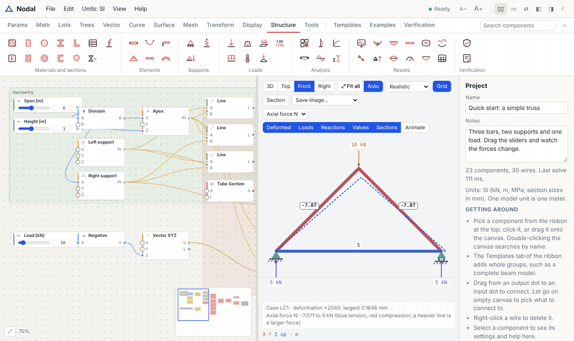](docs/media/templates.gif)

### Results that read like a textbook figure

A plane model opens square-on. Diagrams are filled bands with values at the peaks, loads and reactions are labelled once, and formulas are typeset.

[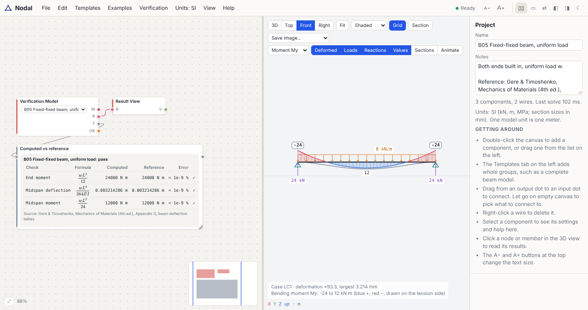](docs/media/beam.png)

### Geometry, structure and results on one canvas

Sliders drive points, points drive lines, lines become truss bars, and the bar forces update while the slider moves. The panel shows the hand-calculated values for this truss: −7.07 kN in the rafters and +5.00 kN in the tie.

[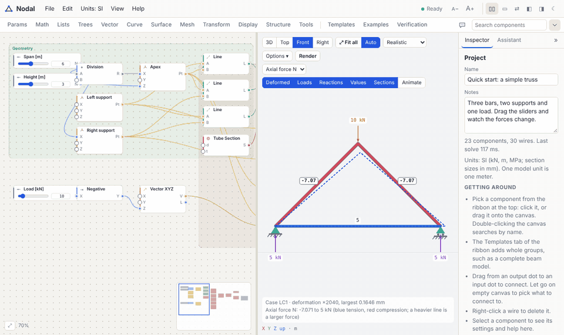](docs/media/truss.gif)

### Parametric structures

A truss bridge whose span, depth and number of panels are sliders. The weight and the midspan deflection are read back into the graph, so they can drive anything else.

[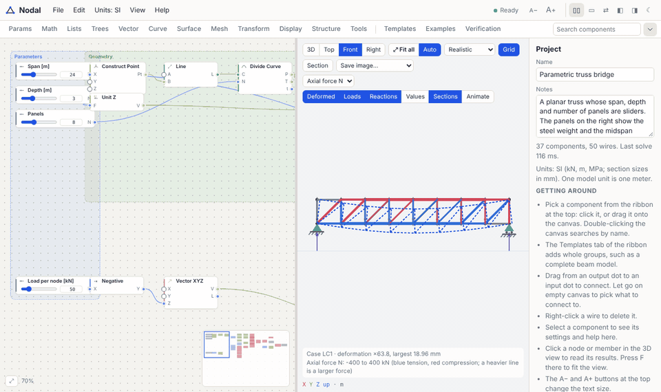](docs/media/bridge.gif)

### Shells with stress contours

A hyperbolic paraboloid (hypar) concrete roof from four corner points, meshed with quadrilateral shell elements. Raising the corners changes the stress pattern as the shell moves from bending toward membrane action.

[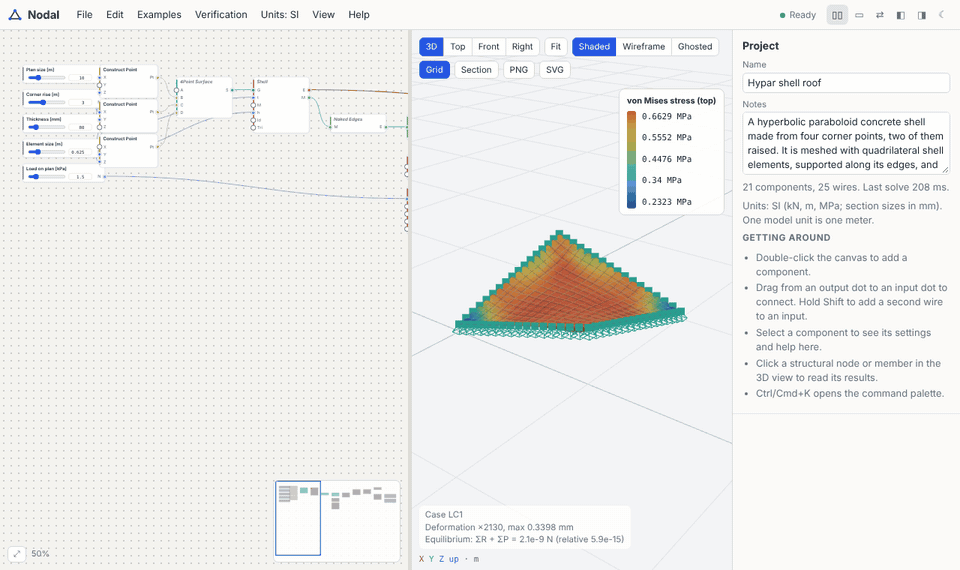](docs/media/shell.gif)

### Form-finding, then analysis

A flat grid of slightly slack lines is loaded upward and relaxed by dynamic relaxation, which gives a hanging-chain shape turned upside down. The found shape is then analyzed as a gridshell of steel tubes.

[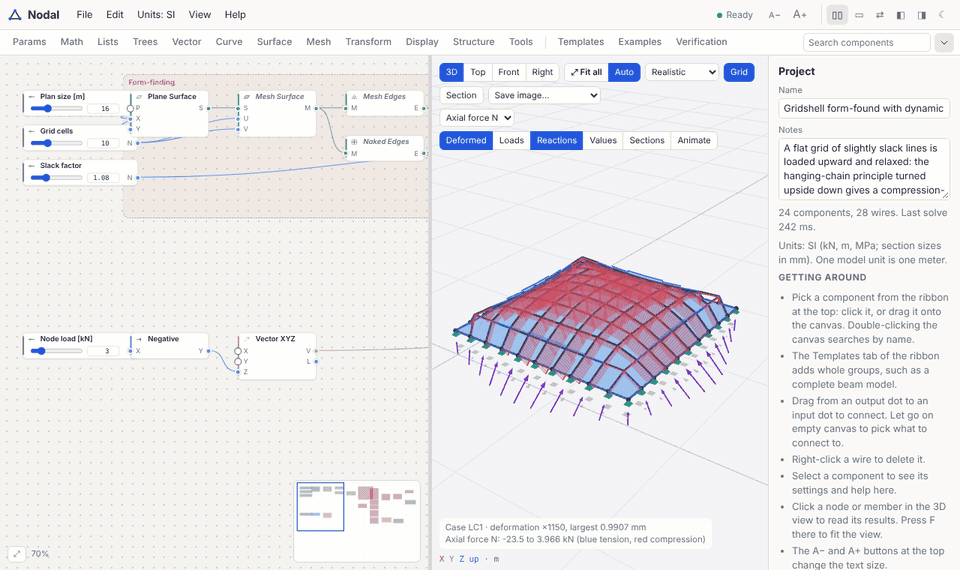](docs/media/gridshell.gif)

### Mode shapes and buckling shapes

Modal analysis of a tapered frame tower. Mode shapes and buckling shapes can be animated, with the frequency or load factor shown.

[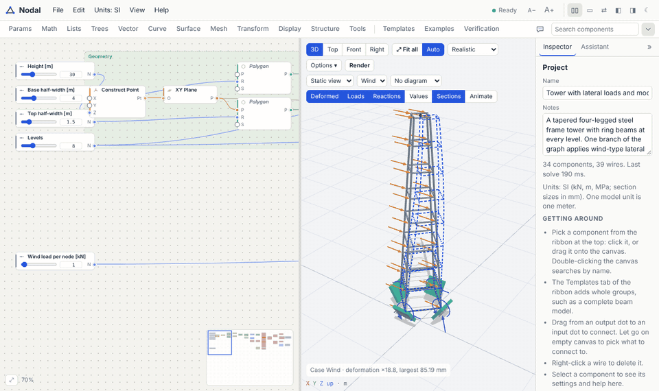](docs/media/modes.gif)

### Optimization that drives the sliders

The evolutionary optimizer changes the width and depth of a beam to minimize its weight under a deflection limit, with a live convergence plot. It lands on the optimum that a hand calculation gives (100 mm wide, about 495 mm deep, about 990 kg).

[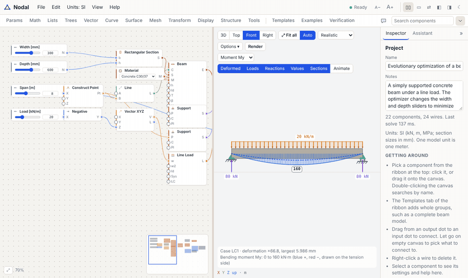](docs/media/optimize.gif)

## What is inside

**Parametric canvas**

- **250+ components** in 14 categories: parameters, math, lists, data trees, vectors and planes, curves, surfaces and solids, meshes, transforms, display, structure, form-finding, optimization and scripting.
- **Data trees** with longest-list, shortest-list and cross-reference matching, plus graft, flatten, simplify, reverse, path mapping and branch extraction.
- **Canvas tools**: fuzzy search on double-click, command palette (Ctrl/Cmd+K), wires colored by type, groups, notes, reusable clusters, undo/redo, copy and paste between projects, minimap, snapping, and help for every component.
- **Templates**: ten ready-made groups of components (seven complete models and three building blocks) that drop into the open project.
- **Easy wiring**: drop a wire on a component or on empty canvas and Nodal offers what fits; right-click a wire to delete it.
- **Readable**: adjustable text size, labels that stay legible when zoomed out, and typeset formulas (KaTeX) in expressions, notes and tables.
- **Geometry**: lines, polylines, arcs, NURBS curves and surfaces, lofts, sweeps, revolves, meshes, Delaunay triangulation and solid booleans.
- **Script component**: your own JavaScript in a sandboxed worker.

**Structural solver**

| | |
|---|---|
| Elements | 3D frame (Euler–Bernoulli or Timoshenko, St. Venant torsion), truss, tension-only, compression-only, cable, springs, quadrilateral and triangular shells |
| Modeling | end releases, rigid offsets, section orientation, rotated supports, prescribed displacements, materials, parametric sections and CSV section tables |
| Loads | point, line (uniform or linear; global, local, projected), self-weight, temperature, area pressure, mesh loads, load cases and combinations |
| Analyses | linear static, second-order (P-Δ and P-δ), linear buckling, modal, geometrically nonlinear for cables and trusses (Newton–Raphson and arc-length) |
| Results | deformed shape with animation, member diagrams, shell contours, reactions, utilization colors, click-to-inspect, sortable result tables with CSV export, an equilibrium check with every analysis |
| Also | section sizing, dynamic relaxation and force density form-finding, evolutionary optimization |

The solver runs in a Web Worker, so the interface stays responsive and a running analysis can be cancelled.

## Verification

[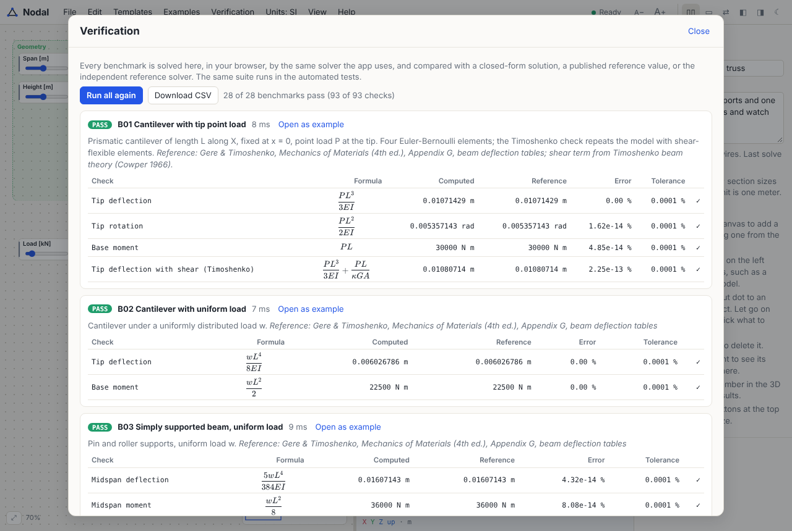](docs/media/verification.png)

All 28 benchmarks pass, in CI and in the in-app Verification panel. A summary (the full table and the convergence plots are in the [verification report](docs/verification-report.md)):

| Group | Benchmarks | Result |
|---|---|---|
| Frames and trusses (16) | beam and frame closed forms, trusses, thermal load, hinges, offsets, a 3D frame against an independent solver | exact to round-off where the theory is exact; within 0.02 % elsewhere |
| Stability and dynamics (5) | Euler buckling, natural frequencies, P-Δ amplification, cable catenary | within 0.004 % for buckling and frequencies, 0.3 % for the cable |
| Shells (7) | Scordelis–Lo roof, pinched cylinder, pinched hemisphere, plates, patch tests | 0.2 %, 1.1 % and 0.07 % on the three classic shell problems; patch tests exact |

A second, deliberately simple solver (dense matrices, a different derivation, no shared code) cross-checks the main solver on 55 randomly generated frames and trusses in every test run.

## Examples included

Open **Examples** in the top bar. Each example states the key results you should see, and the test suite checks those numbers.

A quick-start truss, a parametric truss bridge, a portal frame building with load combinations, a space truss roof generated by a script, a gridshell found by dynamic relaxation, a cable net by the force density method, a hypar shell roof, a tower with modal analysis, section sizing of a truss, an evolutionary beam optimization, and all 28 verification benchmarks as one-click models.

[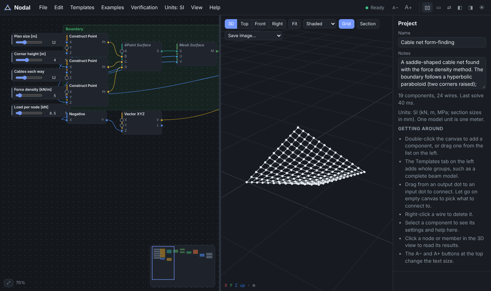](docs/media/dark.png)

## What Nodal is not

- **Not a design-code checker.** There are no code checks in Nodal. Utilization is `(|N|/A + |My|/Wy + |Mz|/Wz) / strength` and nothing more.
- **Not a CAD kernel.** Surfaces are untrimmed NURBS patches and solids are meshes. STEP and IGES are not supported in this version.
- **Not a general nonlinear solver.** Large displacements are followed for cables and trusses. Frames and shells are geometrically linear in the nonlinear analysis (use the second-order analysis for frames). There is no material nonlinearity.
- **Not yet fast for every large model.** About 50,000 degrees of freedom solve in 2 to 5 seconds for plane frames and shells; a 3D building frame of that size takes about 20 seconds. Measurements are in [PROGRESS.md](PROGRESS.md).

The full list is in the [theory manual](docs/theory-manual.md#13-known-limitations).

## Your data

Projects are saved as `.nodal` files (plain JSON) with **File → Save**. The project you are working on is also kept in your browser's storage so it is there when you come back. Nothing leaves your computer.

Import: STL, OBJ, DXF, 3DM, CSV. Export: STL, OBJ, glTF, 3DM, DXF, CSV, and PNG or SVG images of the 3D view and of the canvas.

## Run it offline or host it yourself

Nodal is a static site. Build it once and open `dist/index.html` from any static file server, or copy `dist` to your own host.

```bash
git clone https://github.com/hse95/nodal.git
cd nodal
npm install
npm run dev        # development server
npm run build      # static build in dist/
npm run preview    # serve the build locally
```

## Build and test

```bash
npm test           # unit tests, component tests, examples, and all 28 benchmarks
npm run test:ui    # browser tests against the build (uses the installed Chrome)
npm run docs       # regenerate the verification report and the component reference
npm run bench      # solver timings on models of about 50,000 degrees of freedom
```

| Folder | Contents |
|---|---|
| `src/core` | data trees, expression parser, graph engine, optimizer |
| `src/geom` | curves, NURBS, surfaces, meshes, form-finding |
| `src/fe` | elements, sparse solver, analyses, results |
| `src/ref` | the independent reference solver used for cross-checks |
| `src/verify` | benchmark definitions (JSON), builders and runner |
| `src/components` | the component library |
| `src/ui` | canvas, 3D view, inspector, dialogs |
| `src/examples` | the example gallery |
| `docs` | [user guide](docs/user-guide.md), [theory manual](docs/theory-manual.md), [verification report](docs/verification-report.md), [component reference](docs/component-reference.md) |

Every push to `main` runs the tests and deploys the app to GitHub Pages.

## Credits and feedback

Built by Sam Smith at K-State (email me for feedback: samsmith@ksu.edu)

Nodal uses [Solid](https://www.solidjs.com/), [Three.js](https://threejs.org/), [Manifold](https://github.com/elalish/manifold) and [rhino3dm](https://github.com/mcneel/rhino3dm). See [THIRD_PARTY_LICENSES.md](THIRD_PARTY_LICENSES.md).

## License

[MIT](LICENSE)
