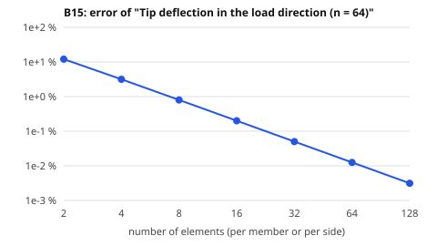
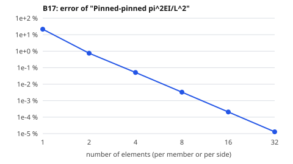
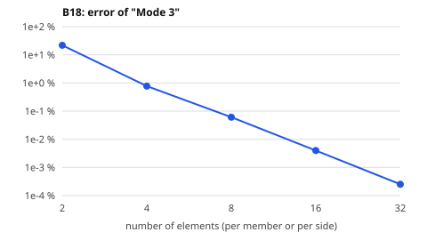
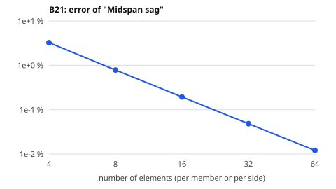
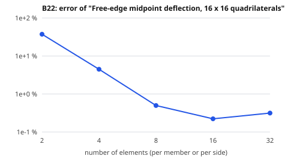
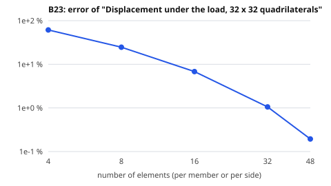
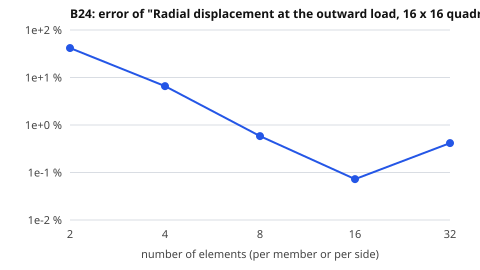
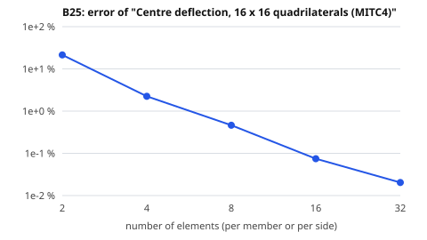
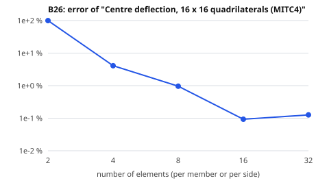
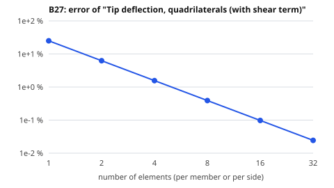

# Verification report

_Generated by `npm run docs` from the benchmark files in `src/verify/benchmarks`. Do not edit by hand._

**28 of 28 benchmarks pass (93 of 93 checks).**

Every benchmark is a JSON file with a description, the source of the reference value, the model parameters, the quantity checked, the expected value and the tolerance. Expected values are evaluated from closed-form formulas in the benchmark parameters wherever one exists; where it does not, they come from code (series, root finding) or from the independent reference solver in `src/ref/refsolver.ts`, which shares no code with the main solver. The same suite runs in the automated tests and in the app (Verification in the top bar).

All benchmark models use SI units (N, m, Pa) unless the source problem is unit-free.

## Summary

| Benchmark | Group | Checks | Largest error | Result |
|---|---|---|---|---|
| [B01 Cantilever with tip point load](#b01) | Frames and trusses | 4 | < 1e-10 % | pass |
| [B02 Cantilever with uniform load](#b02) | Frames and trusses | 2 | < 1e-10 % | pass |
| [B03 Simply supported beam, uniform load](#b03) | Frames and trusses | 3 | < 1e-10 % | pass |
| [B04 Simply supported beam, central point load](#b04) | Frames and trusses | 2 | < 1e-10 % | pass |
| [B05 Fixed-fixed beam, uniform load](#b05) | Frames and trusses | 3 | < 1e-10 % | pass |
| [B06 Propped cantilever, uniform load](#b06) | Frames and trusses | 2 | < 1e-10 % | pass |
| [B07 Two-span continuous beam, uniform load](#b07) | Frames and trusses | 3 | < 1e-10 % | pass |
| [B08 Circular shaft in torsion](#b08) | Frames and trusses | 1 | < 1e-10 % | pass |
| [B09 Beam with an internal hinge](#b09) | Frames and trusses | 4 | < 1e-10 % | pass |
| [B10 Triangular three-bar truss](#b10) | Frames and trusses | 4 | < 1e-10 % | pass |
| [B11 Classic 10-bar planar truss](#b11) | Frames and trusses | 4 | < 1e-10 % | pass |
| [B12 Thermal load on a fixed-fixed bar](#b12) | Frames and trusses | 2 | < 1e-10 % | pass |
| [B13 Portal frame under lateral load](#b13) | Frames and trusses | 8 | 0.00320 % | pass |
| [B14 3D space frame](#b14) | Frames and trusses | 4 | exact to round-off | pass |
| [B15 Curved beam approximated by straight elements](#b15) | Frames and trusses | 1 | 0.0125 % | pass |
| [B16 Rigid offset and end release](#b16) | Frames and trusses | 6 | < 1e-10 % | pass |
| [B17 Euler buckling of columns](#b17) | Stability and dynamics | 4 | 0.00328 % | pass |
| [B18 Cantilever natural frequencies](#b18) | Stability and dynamics | 3 | 0.00164 % | pass |
| [B19 Simply supported beam natural frequencies](#b19) | Stability and dynamics | 4 | 0.00340 % | pass |
| [B20 P-Delta amplification of a cantilever column](#b20) | Stability and dynamics | 3 | 0.415 % | pass |
| [B21 Cable under self-weight](#b21) | Stability and dynamics | 3 | 0.300 % | pass |
| [B22 Scordelis-Lo roof](#b22) | Shells | 2 | 1.57 % | pass |
| [B23 Pinched cylinder with end diaphragms](#b23) | Shells | 1 | 1.06 % | pass |
| [B24 Pinched hemisphere with an 18 degree hole](#b24) | Shells | 2 | 0.0725 % | pass |
| [B25 Simply supported square plate, uniform pressure](#b25) | Shells | 2 | 0.249 % | pass |
| [B26 Clamped square plate, uniform pressure](#b26) | Shells | 2 | 0.772 % | pass |
| [B27 Cantilever plate strip against beam theory](#b27) | Shells | 2 | 0.0625 % | pass |
| [B28 Patch tests for membrane and bending](#b28) | Shells | 12 | 2.50e-10 % | pass |

## Frames and trusses

### B01 Cantilever with tip point load

Prismatic cantilever of length L along X, fixed at x = 0, point load P at the tip. Four Euler-Bernoulli elements; the Timoshenko check repeats the model with shear-flexible elements.

**Reference:** Gere & Timoshenko, Mechanics of Materials (4th ed.), Appendix G, beam deflection tables; shear term from Timoshenko beam theory (Cowper 1966).

**Parameters:** E = 210000000000, nu = 0.3, A = 0.005, I = 0.00004, J = 0.000002, L = 3, n = 4, left = 2, right = 0, Ptip = 10000

| Check | Computed | Reference | Error | Tolerance | Result |
|---|---|---|---|---|---|
| Tip deflection PL^3/3EI | 0.01071429 m | 0.01071429 m | < 1e-10 % | 0.0001 % | pass |
| Tip rotation PL^2/2EI | 0.005357143 rad | 0.005357143 rad | < 1e-10 % | 0.0001 % | pass |
| Base moment PL | 30000 N m | 30000 N m | < 1e-10 % | 0.0001 % | pass |
| Timoshenko tip deflection PL^3/3EI + PL/(kGA) | 0.01080714 m | 0.01080714 m | < 1e-10 % | 0.0001 % | pass |

### B02 Cantilever with uniform load

Cantilever under a uniformly distributed load w.

**Reference:** Gere & Timoshenko, Mechanics of Materials (4th ed.), Appendix G, beam deflection tables

**Parameters:** E = 210000000000, nu = 0.3, A = 0.005, I = 0.00004, J = 0.000002, L = 3, n = 4, left = 2, right = 0, w = 5000

| Check | Computed | Reference | Error | Tolerance | Result |
|---|---|---|---|---|---|
| Tip deflection wL^4/8EI | 0.006026786 m | 0.006026786 m | < 1e-10 % | 0.0001 % | pass |
| Base moment wL^2/2 | 22500 N m | 22500 N m | < 1e-10 % | 0.0001 % | pass |

### B03 Simply supported beam, uniform load

Pin and roller supports, uniform load w.

**Reference:** Gere & Timoshenko, Mechanics of Materials (4th ed.), Appendix G, beam deflection tables

**Parameters:** E = 210000000000, nu = 0.3, A = 0.005, I = 0.00004, J = 0.000002, L = 6, n = 4, left = 1, right = 1, w = 8000

| Check | Computed | Reference | Error | Tolerance | Result |
|---|---|---|---|---|---|
| Midspan deflection 5wL^4/384EI | 0.01607143 m | 0.01607143 m | < 1e-10 % | 0.0001 % | pass |
| Midspan moment wL^2/8 | 36000 N m | 36000 N m | < 1e-10 % | 0.0001 % | pass |
| Support reaction wL/2 | 24000 N | 24000 N | < 1e-10 % | 0.0001 % | pass |

### B04 Simply supported beam, central point load

Pin and roller supports, point load P at midspan.

**Reference:** Gere & Timoshenko, Mechanics of Materials (4th ed.), Appendix G, beam deflection tables

**Parameters:** E = 210000000000, nu = 0.3, A = 0.005, I = 0.00004, J = 0.000002, L = 6, n = 4, left = 1, right = 1, Pmid = 30000

| Check | Computed | Reference | Error | Tolerance | Result |
|---|---|---|---|---|---|
| Midspan deflection PL^3/48EI | 0.01607143 m | 0.01607143 m | < 1e-10 % | 0.0001 % | pass |
| Midspan moment PL/4 | 45000 N m | 45000 N m | < 1e-10 % | 0.0001 % | pass |

### B05 Fixed-fixed beam, uniform load

Both ends built in, uniform load w.

**Reference:** Gere & Timoshenko, Mechanics of Materials (4th ed.), Appendix G, beam deflection tables

**Parameters:** E = 210000000000, nu = 0.3, A = 0.005, I = 0.00004, J = 0.000002, L = 6, n = 4, left = 2, right = 2, w = 8000

| Check | Computed | Reference | Error | Tolerance | Result |
|---|---|---|---|---|---|
| End moment wL^2/12 | 24000 N m | 24000 N m | < 1e-10 % | 0.0001 % | pass |
| Midspan deflection wL^4/384EI | 0.003214286 m | 0.003214286 m | < 1e-10 % | 0.0001 % | pass |
| Midspan moment wL^2/24 | 12000 N m | 12000 N m | < 1e-10 % | 0.0001 % | pass |

### B06 Propped cantilever, uniform load

Fixed at the left end, roller at the right end, uniform load w.

**Reference:** Gere & Timoshenko, Mechanics of Materials (4th ed.), Appendix G, beam deflection tables

**Parameters:** E = 210000000000, nu = 0.3, A = 0.005, I = 0.00004, J = 0.000002, L = 6, n = 4, left = 2, right = 1, w = 8000

| Check | Computed | Reference | Error | Tolerance | Result |
|---|---|---|---|---|---|
| Fixed-end moment wL^2/8 | 36000 N m | 36000 N m | < 1e-10 % | 0.0001 % | pass |
| Reaction at the prop 3wL/8 | 18000 N | 18000 N | < 1e-10 % | 0.0001 % | pass |

### B07 Two-span continuous beam, uniform load

Two equal spans L on three supports, uniform load w on both spans.

**Reference:** Three-moment equation (Clapeyron); e.g. Hibbeler, Structural Analysis (10th ed.), chapter 10

**Parameters:** E = 210000000000, nu = 0.3, A = 0.005, I = 0.00004, J = 0.000002, L = 5, n = 4, spans = 2, left = 1, right = 1, w = 8000

| Check | Computed | Reference | Error | Tolerance | Result |
|---|---|---|---|---|---|
| Interior support moment wL^2/8 | 25000 N m | 25000 N m | < 1e-10 % | 0.0001 % | pass |
| Interior reaction 5wL/4 | 50000 N | 50000 N | < 1e-10 % | 0.0001 % | pass |
| End reaction 3wL/8 | 15000 N | 15000 N | < 1e-10 % | 0.0001 % | pass |

### B08 Circular shaft in torsion

Cantilever shaft with a torque T at the free end.

**Reference:** St. Venant torsion: twist = TL/GJ (Gere & Timoshenko, chapter 3)

**Parameters:** E = 210000000000, nu = 0.3, A = 0.005, I = 0.00004, J = 0.000002, L = 2, n = 3, left = 2, right = 0, T = 2000

| Check | Computed | Reference | Error | Tolerance | Result |
|---|---|---|---|---|---|
| Tip twist TL/GJ | 0.0247619 rad | 0.0247619 rad | < 1e-10 % | 0.0001 % | pass |

### B09 Beam with an internal hinge

Fixed at A (x = 0), roller at C (x = L), moment hinge at x = a, uniform load w. Statically determinate, so all values follow from statics alone.

**Reference:** Statics (Gerber beam)

**Parameters:** E = 210000000000, nu = 0.3, A = 0.005, I = 0.00004, J = 0.000002, L = 5, n = 5, left = 2, right = 1, hinge = 2, w = 6000

| Check | Computed | Reference | Error | Tolerance | Result |
|---|---|---|---|---|---|
| Roller reaction w(L-a)/2 | 9000 N | 9000 N | < 1e-10 % | 0.0001 % | pass |
| Fixed-end reaction wa + w(L-a)/2 | 21000 N | 21000 N | < 1e-10 % | 0.0001 % | pass |
| Fixed-end moment wa^2/2 + w(L-a)a/2 | 30000 N m | 30000 N m | < 1e-10 % | 0.0001 % | pass |
| Moment at the hinge (zero) | 7.27596e-12 N m | 0 N m | 7.3e-12 (absolute) | 0.00001 (absolute) | pass |

### B10 Triangular three-bar truss

Pin at A, roller at B, apex C loaded by P. Member forces from the method of joints.

**Reference:** Method of joints (hand calculation)

**Parameters:** E = 210000000000, nu = 0.3, A = 0.005, I = 0.00004, J = 0.000002, L = 6, h = 4, P = 100000

| Check | Computed | Reference | Error | Tolerance | Result |
|---|---|---|---|---|---|
| Rafter force -P/(2 sin a) | -62500 N | -62500 N | < 1e-10 % | 0.0001 % | pass |
| Tie force P L/(4 h) | 37500 N | 37500 N | < 1e-10 % | 0.0001 % | pass |
| Support reaction P/2 | 50000 N | 50000 N | < 1e-10 % | 0.0001 % | pass |
| Apex deflection (unit-load method) | 4.52381e-4 m | 4.52381e-4 m | < 1e-10 % | 0.0001 % | pass |

### B11 Classic 10-bar planar truss

Two-bay cantilever truss with ten bars (the standard sizing-optimization test geometry), loads P at the two lower free nodes. Compared against the independent dense reference solver.

**Reference:** Independent reference solver (src/ref/refsolver.ts); geometry from Venkayya (1971)

**Parameters:** E = 68950000000, nu = 0.3, A = 0.0064516, a = 9.144, P = 444822

| Check | Computed | Reference | Error | Tolerance | Result |
|---|---|---|---|---|---|
| Tip deflection vs reference solver | 0.1000616 m | 0.1000616 m | < 1e-10 % | 1e-7 % | pass |
| Largest displacement difference (relative) | 3.88339e-15  | 0  | 3.9e-15 (absolute) | 1e-9 (absolute) | pass |
| Largest member-force difference (relative) | 3.70887e-15  | 0  | 3.7e-15 (absolute) | 1e-9 (absolute) | pass |
| Equilibrium error (relative) | 1.85058e-15  | 0  | 1.9e-15 (absolute) | 1e-10 (absolute) | pass |

### B12 Thermal load on a fixed-fixed bar

Uniform temperature rise dT in a bar restrained at both ends, and a through-depth gradient gz in a fully fixed beam.

**Reference:** Restrained thermal expansion: N = -EA alpha dT, M = EI alpha gz (Gere & Timoshenko, sections 2.5 and 9.13)

**Parameters:** E = 210000000000, nu = 0.3, A = 0.005, I = 0.00004, J = 0.000002, alpha = 0.000012, L = 4, n = 2, left = 2, right = 2, dT = 40

| Check | Computed | Reference | Error | Tolerance | Result |
|---|---|---|---|---|---|
| Axial force -EA alpha dT | -5.04000e+5 N | -5.04000e+5 N | < 1e-10 % | 0.0001 % | pass |
| Restraint moment EI alpha gz | 5040 N m | 5040 N m | < 1e-10 % | 0.0001 % | pass |

### B13 Portal frame under lateral load

Single-bay portal frame with a horizontal load H at beam level. Pinned bases are checked by statics, fixed bases by the classical rigid-frame formula and by the reference solver.

**Reference:** Statics; Kleinlogel, Rigid Frame Formulas (1952), frame with fixed feet under a horizontal load at the girder; independent reference solver

**Parameters:** E = 210000000000, nu = 0.3, A = 1, L = 6, h = 4, Ic = 0.00008, Ib = 0.00012, H = 50000, n = 2, base = 1

| Check | Computed | Reference | Error | Tolerance | Result |
|---|---|---|---|---|---|
| Pinned bases: base shear H/2 [note] | 25000.11 N | 25000 N | 0.000450 % | 0.01 % | pass |
| Pinned bases: vertical reaction Hh/L | 33333.33 N | 33333.33 N | 5.31e-10 % | 0.0001 % | pass |
| Pinned bases: knee moment Hh/2 [note] | 1.00000e+5 N m | 1.00000e+5 N m | 0.000450 % | 0.01 % | pass |
| Pinned bases: sway vs reference solver | 0.04762025 m | 0.04762025 m | < 1e-10 % | 0.000001 % | pass |
| Fixed bases: base moment (Hh/2)(3k+1)/(6k+1) [note] | 57144.68 N m | 57142.86 N m | 0.00320 % | 0.1 % | pass |
| Fixed bases: knee moment (Hh/2)(3k)/(6k+1) | 42857.57 N m | 42857.14 N m | 0.000988 % | 0.1 % | pass |
| Fixed bases: sway vs reference solver | 0.01133838 m | 0.01133838 m | < 1e-10 % | 0.000001 % | pass |
| Fixed bases: displacement difference vs reference (relative) | 2.44793e-15  | 0  | 2.4e-15 (absolute) | 1e-8 (absolute) | pass |

Note: Exact only for an inextensible beam; the model area is very large, leaving a difference of a few parts per million.

Note: The formula neglects axial deformation; the model has a very large area so the difference is negligible.

### B14 3D space frame

Irregular one-story 3D frame with a pyramid roof, two truss braces, mixed supports, distributed and nodal loads including moments. Checked for equilibrium and against the reference solver.

**Reference:** Independent reference solver (src/ref/refsolver.ts)

**Parameters:** E = 210000000000, nu = 0.3, w = 8000, H = 20000

| Check | Computed | Reference | Error | Tolerance | Result |
|---|---|---|---|---|---|
| Largest displacement difference (relative) | 3.74817e-14  | 0  | 3.7e-14 (absolute) | 1e-8 (absolute) | pass |
| Largest reaction difference (relative) | 1.40236e-14  | 0  | 1.4e-14 (absolute) | 1e-8 (absolute) | pass |
| Largest axial-force difference (relative) | 1.30838e-14  | 0  | 1.3e-14 (absolute) | 1e-8 (absolute) | pass |
| Equilibrium error (relative) | 4.81333e-15  | 0  | 4.8e-15 (absolute) | 1e-10 (absolute) | pass |

### B15 Curved beam approximated by straight elements

Quarter-circle cantilever of radius R, tip load P perpendicular to the tip tangent. The arc is replaced by n straight Euler-Bernoulli elements; the error falls as n grows.

**Reference:** Castigliano's theorem with bending and axial strain energy: d = pi P R^3/(4EI) + pi P R/(4EA) (Roark's Formulas for Stress and Strain, curved beams)

**Parameters:** E = 210000000000, nu = 0.3, A = 0.005, I = 0.00004, J = 0.000002, R = 2, P = 10000, n = 64

| Check | Computed | Reference | Error | Tolerance | Result |
|---|---|---|---|---|---|
| Tip deflection in the load direction (n = 64) | 0.007494003 m | 0.007494942 m | 0.0125 % | 0.1 % | pass |

Convergence of "Tip deflection in the load direction (n = 64)" with n:

| n | 2 | 4 | 8 | 16 | 32 | 64 | 128 |
|---|---|---|---|---|---|---|---|
| computed | 0.006592133 | 0.0072583 | 0.007435077 | 0.007479932 | 0.007491187 | 0.007494003 | 0.007494708 |
| error | 12.0 % | 3.16 % | 0.799 % | 0.200 % | 0.0501 % | 0.0125 % | 0.00313 % |

### B16 Rigid offset and end release

(a) Cantilever whose tip node sits on a rigid arm of height e, loaded horizontally at that node: the load reaches the member as an axial force and an end moment He. (b) Beam with fixed supports at both ends but a moment release at the right end, which must behave as a propped cantilever.

**Reference:** Hand calculation (statics and the cantilever formulas of benchmark 1)

**Parameters:** E = 210000000000, nu = 0.3, A = 0.005, I = 0.00004, J = 0.000002, L = 3, e = 0.5, H = 20000

| Check | Computed | Reference | Error | Tolerance | Result |
|---|---|---|---|---|---|
| Offset: horizontal displacement HL/EA + He^2L/EI | 0.001842857 m | 0.001842857 m | < 1e-10 % | 0.0001 % | pass |
| Offset: vertical displacement -HeL^2/2EI | -0.005357143 m | -0.005357143 m | < 1e-10 % | 0.0001 % | pass |
| Offset: base moment He | 10000 N m | 10000 N m | < 1e-10 % | 0.0001 % | pass |
| Release: fixed-end moment wL^2/8 (acts as a propped cantilever) | 36000 N m | 36000 N m | < 1e-10 % | 0.0001 % | pass |
| Release: reaction at the released end 3wL/8 | 18000 N | 18000 N | < 1e-10 % | 0.0001 % | pass |
| Release: moment at the released end (zero) | 1.27329e-11 N m | 0 N m | 1.3e-11 (absolute) | 0.00001 (absolute) | pass |

## Stability and dynamics

### B17 Euler buckling of columns

Column of length L under axial load with the four classical end conditions. 16 elements; the convergence study refines the pinned-pinned case.

**Reference:** Euler: Pcr = pi^2 EI/(KL)^2 with K = 1, 2, 0.6992, 0.5 (Timoshenko & Gere, Theory of Elastic Stability, chapter 2)

**Parameters:** E = 210000000000, nu = 0.3, A = 0.005, I = 0.00004, J = 0.000002, L = 4, n = 16, P = 1, bc = 1

| Check | Computed | Reference | Error | Tolerance | Result |
|---|---|---|---|---|---|
| Pinned-pinned  pi^2EI/L^2 | 5.18155e+6 N | 5.18154e+6 N | 0.000206 % | 0.1 % | pass |
| Fixed-free  pi^2EI/(2L)^2 | 1.29539e+6 N | 1.29539e+6 N | 0.0000129 % | 0.1 % | pass |
| Fixed-pinned  20.1907 EI/L^2 | 1.06002e+7 N | 1.06001e+7 N | 0.000860 % | 0.1 % | pass |
| Fixed-fixed  pi^2EI/(0.5L)^2 | 2.07268e+7 N | 2.07262e+7 N | 0.00328 % | 0.1 % | pass |

Convergence of "Pinned-pinned  pi^2EI/L^2" with n:

| n | 1 | 2 | 4 | 8 | 16 | 32 |
|---|---|---|---|---|---|---|
| computed | 6.30000e+6 | 5.22052e+6 | 5.18420e+6 | 5.18171e+6 | 5.18155e+6 | 5.18154e+6 |
| error | 21.6 % | 0.752 % | 0.0512 % | 0.00328 % | 0.000206 % | 0.0000129 % |

### B18 Cantilever natural frequencies

First three bending frequencies of a cantilever, consistent mass, 20 elements.

**Reference:** Euler-Bernoulli beam theory: f = (bL)^2/(2 pi L^2) sqrt(EI/rho A), bL = 1.8751, 4.6941, 7.8548 (Blevins, Formulas for Natural Frequency and Mode Shape)

**Parameters:** E = 210000000000, nu = 0.3, rho = 7850, A = 0.0025, I = 5.2083333e-7, J = 8.8e-7, L = 3, n = 20, bc = 2

| Check | Computed | Reference | Error | Tolerance | Result |
|---|---|---|---|---|---|
| Mode 1 (bL = 1.8751) | 4.641759 Hz | 4.641759 Hz | 0.00000533 % | 0.1 % | pass |
| Mode 2 (bL = 4.6941) | 29.08947 Hz | 29.08941 Hz | 0.000210 % | 0.1 % | pass |
| Mode 3 (bL = 7.8548) | 81.45251 Hz | 81.45118 Hz | 0.00164 % | 0.1 % | pass |

Convergence of "Mode 3 (bL = 7.8548)" with n:

| n | 2 | 4 | 8 | 16 | 32 |
|---|---|---|---|---|---|
| computed | 99.22057 | 82.0818 | 81.50072 | 81.45442 | 81.45138 |
| error | 21.8 % | 0.774 % | 0.0608 % | 0.00398 % | 0.000251 % |

### B19 Simply supported beam natural frequencies

First three bending frequencies of a simply supported beam, consistent mass, 20 elements.

**Reference:** f_n = (n^2 pi/2L^2) sqrt(EI/m) (Blevins)

**Parameters:** E = 210000000000, nu = 0.3, rho = 7850, A = 0.0025, I = 5.2083333e-7, J = 8.8e-7, L = 3, n = 20, bc = 1

| Check | Computed | Reference | Error | Tolerance | Result |
|---|---|---|---|---|---|
| Mode 1 | 13.02962 Hz | 13.02961 Hz | 0.0000422 % | 0.1 % | pass |
| Mode 2 | 52.11881 Hz | 52.11846 Hz | 0.000675 % | 0.1 % | pass |
| Mode 3 | 117.2705 Hz | 117.2665 Hz | 0.00340 % | 0.1 % | pass |
| Mode 1 with lumped mass | 13.02961 Hz | 13.02961 Hz | 0.0000425 % | 0.1 % | pass |

### B20 P-Delta amplification of a cantilever column

Cantilever column with axial load P (about 31 % of the Euler load) and lateral tip load H, second-order analysis with 8 elements.

**Reference:** Exact beam-column solution: Timoshenko & Gere, Theory of Elastic Stability, art. 1.4; approximate amplification factor 1/(1 - P/Pcr)

**Parameters:** E = 210000000000, nu = 0.3, A = 0.005, I = 0.00004, J = 0.000002, L = 4, n = 8, P = 400000, H = 10000, bc = 2, second = 1

| Check | Computed | Reference | Error | Tolerance | Result |
|---|---|---|---|---|---|
| Tip sway vs exact beam-column solution | 0.03658991 m | 0.03658992 m | 0.0000283 % | 0.1 % | pass |
| Base moment vs exact beam-column solution | 54635.96 N m | 54635.97 N m | 0.00000758 % | 0.1 % | pass |
| Tip sway vs approximate factor 1/(1 - P/Pcr) [note] | 0.03658991 m | 0.03674247 m | 0.415 % | 2 % | pass |

Note: The amplification factor is itself an approximation, so a difference of about 1 % is expected.

### B21 Cable under self-weight

Elastic cable with unstressed length L0 hung between level supports a distance `span` apart, 40 cable elements, geometrically nonlinear analysis starting from the straight slack chord.

**Reference:** Elastic catenary: Irvine, Cable Structures (1981), section 1.4

**Parameters:** span = 100, L0 = 102, E = 160000000000, A = 0.0005, rho = 7850, n = 40

| Check | Computed | Reference | Error | Tolerance | Result |
|---|---|---|---|---|---|
| Midspan sag | 8.739324 m | 8.736624 m | 0.0309 % | 0.5 % | pass |
| Horizontal reaction | 5560.299 N | 5561.918 N | 0.0291 % | 0.5 % | pass |
| Maximum tension | 5880.494 N | 5898.176 N | 0.300 % | 0.5 % | pass |

Convergence of "Midspan sag" with n:

| n | 4 | 8 | 16 | 32 | 64 |
|---|---|---|---|---|---|
| computed | 9.019653 | 8.804893 | 8.753543 | 8.740845 | 8.737679 |
| error | 3.24 % | 0.781 % | 0.194 % | 0.0483 % | 0.0121 % |

## Shells

### B22 Scordelis-Lo roof

Cylindrical roof (R = 25, L = 50, t = 0.25, 80 degree arc, E = 4.32e8, nu = 0) on rigid end diaphragms under gravity load 90 per unit area. One quarter is modeled; the vertical displacement at the middle of the free edge is checked.

**Reference:** MacNeal & Harder, 'A proposed standard set of problems to test finite element accuracy', Finite Elements in Analysis and Design 1 (1985) 3-20; reference 0.3024 (the value MacNeal & Harder and Belytschko et al. 1985 normalize by; Scordelis & Lo's own value is 0.3086, and Krysl & Chen 2022 argue for 0.3006 for shear-rigid shells).

**Parameters:** R = 25, L = 50, t = 0.25, theta = 40, E = 432000000, nu = 0, q = 90, n = 16

| Check | Computed | Reference | Error | Tolerance | Result |
|---|---|---|---|---|---|
| Free-edge midpoint deflection, 16 x 16 quadrilaterals | 0.3017274  | 0.3024  | 0.222 % | 2 % | pass |
| Same, 32 x 32 triangles | 0.2976384  | 0.3024  | 1.57 % | 5 % | pass |

Convergence of "Free-edge midpoint deflection, 16 x 16 quadrilaterals" with n:

| n | 2 | 4 | 8 | 16 | 32 |
|---|---|---|---|---|---|
| computed | 0.4155161 | 0.3159414 | 0.303905 | 0.3017274 | 0.3014474 |
| error | 37.4 % | 4.48 % | 0.498 % | 0.222 % | 0.315 % |

### B23 Pinched cylinder with end diaphragms

Cylinder (R = 300, L = 600, t = 3, E = 3e6, nu = 0.3) with rigid end diaphragms, pinched by two opposite unit loads at mid-length. One octant is modeled.

**Reference:** MacNeal & Harder, 'A proposed standard set of problems to test finite element accuracy', Finite Elements in Analysis and Design 1 (1985) 3-20; Belytschko, Stolarski, Liu, Carpenter & Ong, CMAME 51 (1985) 221-258; reference 1.8248e-5.

**Parameters:** R = 300, L = 600, t = 3, E = 3000000, nu = 0.3, P = 1, n = 32

| Check | Computed | Reference | Error | Tolerance | Result |
|---|---|---|---|---|---|
| Displacement under the load, 32 x 32 quadrilaterals | 1.80555e-5  | 1.82480e-5  | 1.06 % | 5 % | pass |

Convergence of "Displacement under the load, 32 x 32 quadrilaterals" with n:

| n | 4 | 8 | 16 | 32 | 48 |
|---|---|---|---|---|---|
| computed | 7.06329e-6 | 1.37499e-5 | 1.70055e-5 | 1.80555e-5 | 1.82834e-5 |
| error | 61.3 % | 24.6 % | 6.81 % | 1.06 % | 0.194 % |

### B24 Pinched hemisphere with an 18 degree hole

Hemisphere (R = 10, t = 0.04, E = 6.825e7, nu = 0.3) with an 18 degree hole at the pole, loaded by alternating radial unit loads on the equator (one quadrant modeled).

**Reference:** MacNeal & Harder, 'A proposed standard set of problems to test finite element accuracy', Finite Elements in Analysis and Design 1 (1985) 3-20 (who quote 0.0940); the value 0.093 specified for this project is the one commonly used with later converged solutions (e.g. Simo, Fox & Rifai, CMAME 72 (1989)).

**Parameters:** R = 10, t = 0.04, E = 68250000, nu = 0.3, F = 1, hole = 18, n = 16

| Check | Computed | Reference | Error | Tolerance | Result |
|---|---|---|---|---|---|
| Radial displacement at the outward load, 16 x 16 quadrilaterals | 0.09306745  | 0.093  | 0.0725 % | 3 % | pass |
| Radial displacement at the inward load | 0.09306745  | 0.093  | 0.0725 % | 3 % | pass |

Convergence of "Radial displacement at the outward load, 16 x 16 quadrilaterals" with n:

| n | 2 | 4 | 8 | 16 | 32 |
|---|---|---|---|---|---|
| computed | 0.05420961 | 0.08688076 | 0.09245735 | 0.09306745 | 0.09338705 |
| error | 41.7 % | 6.58 % | 0.583 % | 0.0725 % | 0.416 % |

### B25 Simply supported square plate, uniform pressure

Thin square plate (t/a = 0.01) with hard simple supports under uniform pressure.

**Reference:** Navier double-sine series (Timoshenko & Woinowsky-Krieger, Theory of Plates and Shells, art. 30), summed in the test code; coefficient 0.00406235 q a^4 / D

**Parameters:** a = 2, t = 0.02, E = 200000000000, nu = 0.3, q = 1000, n = 16, bc = 1

| Check | Computed | Reference | Error | Tolerance | Result |
|---|---|---|---|---|---|
| Center deflection, 16 x 16 quadrilaterals (MITC4) | 4.43278e-4 m | 4.43609e-4 m | 0.0746 % | 2 % | pass |
| Center deflection, 16 x 16 x 2 triangles (DKT) | 4.42503e-4 m | 4.43609e-4 m | 0.249 % | 2 % | pass |

Convergence of "Center deflection, 16 x 16 quadrilaterals (MITC4)" with n:

| n | 2 | 4 | 8 | 16 | 32 |
|---|---|---|---|---|---|
| computed | 3.48507e-4 | 4.33655e-4 | 4.41556e-4 | 4.43278e-4 | 4.43699e-4 |
| error | 21.4 % | 2.24 % | 0.463 % | 0.0746 % | 0.0204 % |

### B26 Clamped square plate, uniform pressure

Thin square plate (t/a = 0.01) with all edges clamped under uniform pressure.

**Reference:** Timoshenko & Woinowsky-Krieger, Theory of Plates and Shells, art. 44 (0.00126 q a^4 / D); the more precise coefficient 0.00126532 is from Taylor & Govindjee, Commun. Numer. Meth. Engng 20 (2004)

**Parameters:** a = 2, t = 0.02, E = 200000000000, nu = 0.3, q = 1000, n = 16, bc = 2

| Check | Computed | Reference | Error | Tolerance | Result |
|---|---|---|---|---|---|
| Center deflection, 16 x 16 quadrilaterals (MITC4) | 1.38045e-4 m | 1.38173e-4 m | 0.0930 % | 2 % | pass |
| Center deflection, 16 x 16 x 2 triangles (DKT) | 1.39240e-4 m | 1.38173e-4 m | 0.772 % | 2 % | pass |

Convergence of "Center deflection, 16 x 16 quadrilaterals (MITC4)" with n:

| n | 2 | 4 | 8 | 16 | 32 |
|---|---|---|---|---|---|
| computed | 2.92500e-7 | 1.32506e-4 | 1.36844e-4 | 1.38045e-4 | 1.38348e-4 |
| error | 99.8 % | 4.10 % | 0.962 % | 0.0930 % | 0.126 % |

### B27 Cantilever plate strip against beam theory

Plate strip (L = 10, b = 1, t = 0.1, nu = 0) clamped at one end with a tip load, modeled with shell elements. With nu = 0 the strip is a beam.

**Reference:** Beam theory: PL^3/3EI, plus PL/(kGA) for the shear-flexible quadrilateral

**Parameters:** L = 10, b = 1, t = 0.1, E = 10000000, P = 10, n = 20, nb = 2

| Check | Computed | Reference | Error | Tolerance | Result |
|---|---|---|---|---|---|
| Tip deflection, quadrilaterals (with shear term) | 3.99774 m | 4.00024 m | 0.0625 % | 0.5 % | pass |
| Tip deflection, triangles (thin-plate theory) | 4.000195 m | 4 m | 0.00488 % | 0.5 % | pass |

Convergence of "Tip deflection, quadrilaterals (with shear term)" with n:

| n | 1 | 2 | 4 | 8 | 16 | 32 |
|---|---|---|---|---|---|---|
| computed | 3.00024 | 3.75024 | 3.93774 | 3.984615 | 3.996334 | 3.999263 |
| error | 25.0 % | 6.25 % | 1.56 % | 0.391 % | 0.0977 % | 0.0244 % |

### B28 Patch tests for membrane and bending

Five-element distorted patch (0.24 x 0.12). The boundary nodes are driven by a constant-strain field (membrane) or a constant-curvature field (bending); a valid element must reproduce the field at the interior nodes and give constant stress resultants.

**Reference:** MacNeal & Harder, 'A proposed standard set of problems to test finite element accuracy', Finite Elements in Analysis and Design 1 (1985) 3-20, patch test for plates (fig. 2); exact values: membrane stresses 1333 and 400, bending moments 1.111e-7 and 3.333e-8 per unit length

**Parameters:** E = 1000000, nu = 0.25, t = 0.001, mode = 1

| Check | Computed | Reference | Error | Tolerance | Result |
|---|---|---|---|---|---|
| Membrane, quadrilaterals: interior displacement error | 7.45149e-15  | 0  | 7.5e-15 (absolute) | 1e-9 (absolute) | pass |
| Membrane, quadrilaterals: direct force error | 8.32667e-16  | 0  | 8.3e-16 (absolute) | 1e-9 (absolute) | pass |
| Membrane, quadrilaterals: shear force error | 2.22045e-15  | 0  | 2.2e-15 (absolute) | 1e-9 (absolute) | pass |
| Membrane force Nx = 1333.3 t | 1.333333 N/m | 1.333333 N/m | < 1e-10 % | 1e-7 % | pass |
| Bending, quadrilaterals: interior displacement error | 2.57224e-12  | 0  | 2.6e-12 (absolute) | 1e-8 (absolute) | pass |
| Bending, quadrilaterals: moment error | 5.70985e-12  | 0  | 5.7e-12 (absolute) | 1e-8 (absolute) | pass |
| Bending, quadrilaterals: twisting moment error | 6.47166e-12  | 0  | 6.5e-12 (absolute) | 1e-8 (absolute) | pass |
| Bending moment Mx = -1.111e-7 | -1.11111e-7 N m/m | -1.11111e-7 N m/m | 2.50e-10 % | 0.000001 % | pass |
| Membrane, triangles: interior displacement error | 2.64051e-15  | 0  | 2.6e-15 (absolute) | 1e-9 (absolute) | pass |
| Membrane, triangles: direct force error | 1.49880e-15  | 0  | 1.5e-15 (absolute) | 1e-9 (absolute) | pass |
| Bending, triangles: interior displacement error | 4.06576e-16  | 0  | 4.1e-16 (absolute) | 1e-8 (absolute) | pass |
| Bending, triangles: moment error | 4.76456e-15  | 0  | 4.8e-15 (absolute) | 1e-8 (absolute) | pass |
